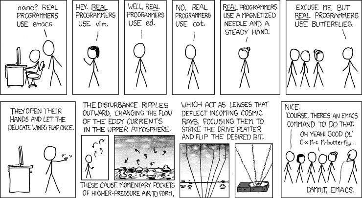

A common critique of producing images, music, and (creative) writing with generative "AI" tools (specifically [large language models](https://en.wikipedia.org/wiki/Large_language_model), a.k.a. LLMs, like ChatGPT), is that these are *artistic* pursuits that cannot truly be decoupled from human creativity. Something — perhaps many things — are lost in the process of automating away everything except the end "product". It is *less* common to see this critique applied to coding and developing software. In some ways this makes a lot of sense; code is already tightly entangled with computers, automation, efficiency, logic. Surely, of all possible use cases, this is one where generative "AI" could shine?

And yet, I do not use LLMs to write code. I am not interested in "[vibe coding](https://en.wikipedia.org/wiki/Vibe_coding)". I am put off from contributing to other projects which *do* use LLMs. This is not *just* because of the social, ecological, and structural harms baked into LLMs as they exist today. [^1] Even if we could strip away all of those "externalities" overnight, and [seize the means of computation](https://archive.org/details/SeaGL2021-Cory_Doctorow-Seize_the_Means_of_Computation) from big tech companies in order to run our own LLMs locally, I would still not want to use them for *most* things.

For me, coding is a craft. It's playful. It's something that I'm (semi) competent at. It's *creative*. It's enjoyable! I no more want to outsource the process of coding to an LLM than most artists wants to outsource their drawing or painting to one. Despite the growing use of LLMs in software development, the perceived boosts in productivity are coming at the cost of huge drops in motivation and hope for the future, alongside huge boosts in stress, anxiety, and burn out. [^2]

At the same time, I'm reluctant to dismiss out of hand the urge, especially in non-coders, to use LLMs to create software in ways that were previously out of reach. While much "AI"-generated code is being produced under the spectre of endless capitalist accumulation, profit-maximising, and commodification, not all of it is. As computers and tech continue to play an increasingly large  role in our lives, isn't it reasonable for more people to be able to create their own software, if they want to? To be able to get computers to do stuff without always relying on nerds like me?
## What is coding (for) anyway?

I must admit that it nonetheless stings when people treat writing code purely as means to an end; drudgery to be optimized away; an unnecessary time sink. That's my livelihood, ya know! And my hobby. A passion, even? But I'm not opposed to all forms of automation, and I'm not opposed to people being able to get what they need without always having to *struggle* for it. So what *is* coding exactly? What are its squishier, more human components that might have some intrinsic value? What's actually worth defending against the "AI" onslaught? And could (or should) these elements be made more accessible to a wider audience?

All coding relies on layers of abstraction, but the specific number of layers can vary considerably. Programming languages come in many flavours. "Higher level" languages are farther away (more abstracted) from the "metal", i.e. physical computer hardware. Complexity increases as we move down the ladder of abstraction, and all human-readable code eventually gets translated into "machine code" that is generally impractical for humans to produce directly. (Beyond this lies the realm of transistors and physics which is well beyond *my* area of expertise.)

There's a lot of ego in certain circles of software development, and it's not uncommon for programmers to consider some kinds of coding more *real*, more *serious*, more *proper* than others. Nonetheless, even if most of us programmers don't work at those lower levels of abstraction *directly*, it's still useful to *understand* what's going on down there. If you study computer science more formally you learn those fundamentals, not because you're necessarily going to use them day-to-day, but because they help you write better code nearer the top of the abstraction ladder.

[Anna Liberty](https://gracefulliberty.com/) argues that one problem with LLMs in this domain is that they are presented as an extra layer of abstraction, when in reality they're just the *automation* of existing layers. For an abstraction to be useful, it needs to be legible and reliable. LLMs are not only non-deterministic (they produce different results based on the same inputs), they are also black boxes that obscure underlying logics, rather than elucidating them. They often make it *harder* to understand and reason about code, which makes it harder to fix their mistakes and untangle their messes [^3]

Anna instead argues for what she calls "[understandable software](https://gracefulliberty.com/articles/towards-understandable-software/)". Although she rejects LLMs, she is interested in new ways of coding that leverage natural language processing, in contrast to the often arcane syntax of many of our current programming languages. She speculates that such approaches could live alongside the more traditional forms of coding we have now, as well as the likes of visual scripting, in order to lower the barrier to entry for coding *without* eroding its foundations or deskilling its practitioners.

> I support creating a higher-level approach to programming that more closely resembles natural language. I want everyone to be able to exercise control over their computers. LLMs just aren't the model for that.

<cite>— [A Pragmatic Approach to LLMs](https://gracefulliberty.com/articles/pragmatic-llms/) [^4]</cite>

Whether or not this is the best wary forward, I certainly agree that it shouldn't be incumbent on everyone who wants to code to first take a two year foundational computer science course! Coding is, in my view, much more about systematic thinking, designing, architecting, problem solving, debugging, and communication than it is about whether I'm writing `"mov eax, 4"`, `"var = 4;"`, or even "writing" code at all. I believe it's possible to operate at higher levels of abstraction and still maintain (and even build!) foundational skills and knowledge, at various levels of commitment to the craft of coding. I just don't think LLMs are a good tool for that.
## We're in this together

Despite pop culture imagery of solitary figures tapping away at keyboards in the dark, software development is (or can be) an incredibly collaborative process. Yes, it's possible to develop many things on your own, but most software of even moderate size or complexity takes many hands and minds. One of the myths reinforced by LLMs is that we can (and should) be able to do all of this on our own (with the help of a handy chatbot). It's a highly individualistic narrative that speaks to our atomised culture of personal achievement and responsibility, but it leaves a lot out.

Free and open source software is arguably one of the best examples of a shared [commons](https://en.wikipedia.org/wiki/Commons) in the modern world. And yet the proliferation of "AI" tools could be putting all that in jeopardy. LLMs may be able generate code very quickly, but that code still needs to (or at least *should*) be reviewed and understood by humans, yet "low quality" LLM-generated code contributions has surged so much that it's putting serious pressure on already-stretched project maintainers. [^5]

Creating software means spending at least as much time *reading* code as *writing* it. High-quality code doesn't just mean code that "works", it means code that can be readily understood, modified, extended, maintained, and built upon by other people. Ideally code is self-documenting — anyone can come along and make sense of it just by looking at it — but realistically it's often useful to be able to ask the original authors about their intention or process. Once LLM-generated code is in a project it's no longer possible to do that. The "thought process" is lost forever.

Hidden behind concepts like the "[10x engineer](https://dev.to/shelan/who-is-a-10x-engineer-153m)" (uniquely productive programmers) is the idea that the best programmers are those who, when given a problem to solve, can head off on their own and use nothing but their individual expertise and arcane knowledge to get the job done. Yet, while I'm all for deepening knowledge and expertise, this ignores the reality that we don't *need* to be able to do everything ourselves. When we're working with others we don't need to understand everything, or be the best at everything. We can create things together that we couldn't create alone, and in a much more human and fulfilling way than "collaborating" with an LLM.
## What to do in the meantime?

It's becoming harder and harder to opt out of working on coding projects that rely on LLMs. [Linus Torvalds](https://en.wikipedia.org/wiki/Linus_Torvalds) stirred up quite a fuss when he start using LLMs to "vibe code" his hobby projects, despite clearly being a *very* accomplished and experienced software developer in his own right. His stance on "AI" now extends to welcoming LLM-generated code in open source projects (including Linux) and being critical of anyone advocating for outright LLM bans. [^6]

I have so far managed to largely avoid LLMs both professionally and personally, and it's my intention to keep doing so for as long as humanly possible. And while I'm under no illusions that individually opting out is going to do much to address the systems and structures that brought us "AI" in the first place, I resonate with slavery historian [Jessica Marie Johnson](https://substack.com/@jessicamariejohnson) when she says:

> I continue to believe a small act of non-compliance and opting-out everywhere will not only boost my morale, but, in the long run, will cool my nervous system and save brain cells and attention deficits that I need in my present and future age.

<cite>— [A Reformed Ai Hater](https://substack.com/home/post/p-222380014) [^7]</cite>

In the spirit of keeping my nervous system cool, I do want to extend more grace to those who see all of this differently to me. Especially those who are using "AI" and LLMs to: survive, to get by, to claw back some time and energy from the exploitative capitalist systems that surround us all; those fellow nerds who would *love* to be developing software more collaboratively (as I advocate for above) but don't have the time, resources, or community to do so right now.

I nevertheless remain committed to the abolition of "AI" in almost all of its current forms, and to the fight for more liberatory forms of community-centric technology. I want to keep writing my own code, even when it's bad code. *Especially* when it's bad code, because that's how I get better and continue to develop my craft. I don't want to give up the satisfaction of solving a problem; failures and bumps in the road included. I don't even want to outsource "easy" problems to LLMs, I'd rather strive to use those to create opportunities for newer coders to learn from. [^8]

I want to learn from those who find themselves drawn to "AI" in order to better understand what unmet needs those tools are speaking to, so that we might collectively explore less harmful ways of meeting those needs in the future.

> Technology is neither good nor bad; nor is it neutral.

<cite>— [Technology and History: "Kranzberg's Laws"](https://www.jstor.org/stable/3105385) [^9]</cite>

[^1]: [Critical Questions about "AI"](https://karnbianco.co.uk/writing/critical-questions-about-ai/), Karn Bianco (July, 2024)
[^2]: [The State of the Devs 2026 Survey](https://2026.stateofdevs.com/en-US/) (September, 2026)
[^3]: [A Pragmatic Approach to LLMs](https://gracefulliberty.com/articles/pragmatic-llms/), Anna Liberty (June, 2026)
[^4]: [Towards Understandable Software](https://gracefulliberty.com/articles/towards-understandable-software/), Anna Libery (March, 2026)
[^5]: [GitHub ponders kill switch for pull requests to stop AI slop](https://www.theregister.com/software/2026/02/03/github-ponders-kill-switch-for-pull-requests-to-stop-ai-slop/4334869), The Register (February, 2026)
[^6]: [Linus Torvalds to critics of AI coding in Linux: "Fork it. Or just walk away."](https://arstechnica.com/ai/2026/07/linus-torvalds-to-critics-of-ai-coding-in-linux-fork-it-or-just-walk-away/), Ars Technica (July, 2026)
[^7]: [A Reformed Ai Hater](https://substack.com/home/post/p-222380014), Jessica Marie Johnson (October 2026)
[^8]: [The paradox at the heart of AI and science](https://www.youtube.com/watch?v=svl_1upFpQo), Terence Tao (September, 2026)
[^9]: [Technology and History: "Kranzberg's Laws"](https://www.jstor.org/stable/3105385), JSTOR (July, 1986)